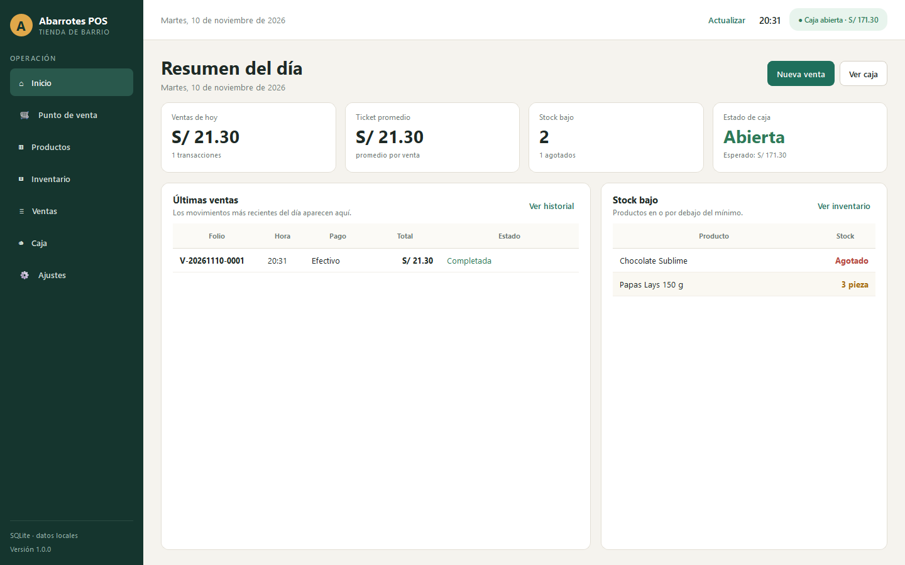
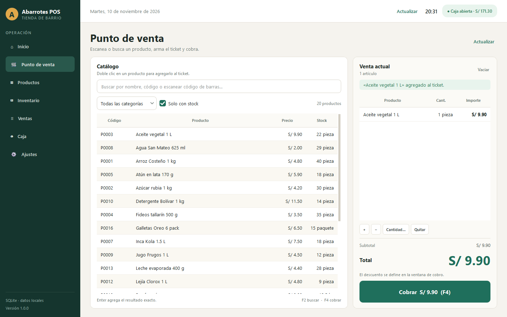
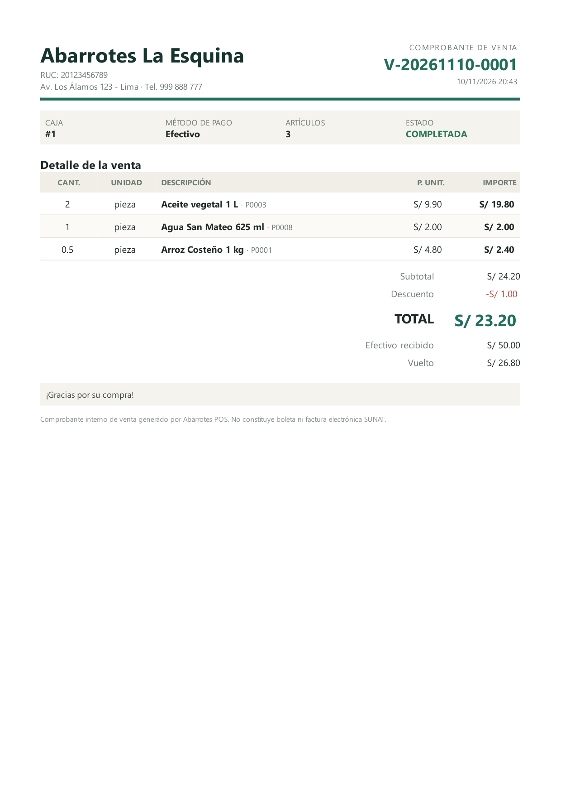

# Abarrotes POS

Punto de venta de escritorio para una tienda de abarrotes. Funciona sin internet, guarda todo en un archivo SQLite y está pensado para operar el mostrador desde Windows con teclado o lector de código de barras USB.

**Stack:** Python 3.10+ · PySide6 · SQLite 3  
**Moneda:** Soles peruanos (S/)  
**Idioma:** Español



## Funciones incluidas

- **Punto de venta:** búsqueda por nombre, SKU o código de barras, carrito con cantidades decimales, descuento global, cobro en efectivo con vuelto, tarjeta o transferencia.
- **Comprobante interno:** folio diario, detalle de productos, totales, vuelto e impresión mediante el diálogo de impresión de Windows.
- **Boletas PDF:** cada venta genera automáticamente un PDF A4 en `data/boletas/AAAA/MM/`, con opción de abrirlo, guardar una copia y regenerarlo desde el historial.
- **Caja:** apertura con fondo, ingresos/egresos, devoluciones, efectivo esperado y cierre con arqueo y diferencia.
- **Productos:** alta, edición, códigos único de barras, precios, costo, stock mínimo, categorías y activación/desactivación.
- **Inventario:** entradas de mercancía, mermas, ajustes por conteo, alertas de stock bajo y bitácora de movimientos.
- **Ventas:** historial filtrable, detalle de ticket y anulación con restauración de stock.
- **Ajustes:** datos del negocio para el comprobante y copias de seguridad desde la aplicación.
- **Datos demo:** 21 productos de abarrotes listos para probar en el primer inicio.

## Capturas





## Boletas en PDF

Al confirmar una venta se crea automáticamente una boleta PDF en:

```text
data\boletas\AAAA\MM\V-AAAAMMDD-####.pdf
```

- En el diálogo de venta puedes usar **Abrir PDF** o **Guardar copia** para enviarla por correo o imprimirla en una hoja A4.
- En **Ventas**, selecciona una venta y pulsa **Generar PDF** para recuperar o regenerar el archivo. Si la venta está anulada, el PDF muestra el estado **ANULADA** y el motivo.
- En **Ajustes → Abrir boletas PDF** se abre la carpeta donde se guardan.
- El PDF es un **comprobante interno** en formato A4 y no sustituye una boleta electrónica SUNAT.
- La impresión térmica sigue disponible con **Imprimir comprobante** en el diálogo de venta.
- Para guardar los PDF en otra ubicación, define `POS_PDF_DIR` antes de arrancar:

```powershell
$env:POS_PDF_DIR = "D:\Documentos\Boletas"
python main.py
```

## Requisitos

- Python 3.10 o superior.
- Windows 10/11, Linux o macOS con entorno gráfico.
- PySide6 6.8 o superior (`requirements.txt`).

## Instalación

### Windows con PowerShell

```powershell
cd "C:\ruta\a\punto-venta-tienda"
python -m venv .venv
.\.venv\Scripts\Activate.ps1
pip install -r requirements.txt
python main.py
```

Si PowerShell bloquea la activación del entorno:

```powershell
Set-ExecutionPolicy -Scope Process -ExecutionPolicy Bypass
.\.venv\Scripts\Activate.ps1
```

También puedes hacer doble clic en `iniciar.bat`; usará `.venv` automáticamente si existe.

### Linux / macOS

```bash
python3 -m venv .venv
source .venv/bin/activate
pip install -r requirements.txt
python main.py
```

## Primer uso

1. Abre la aplicación.
2. Ve a **Caja** y pulsa **Abrir caja**. Registra el fondo inicial del turno.
3. En **Punto de venta**, busca un producto y agrégalo con doble clic o `Enter`.
4. Pulsa **Cobrar** o `F4`, elige el método de pago y confirma.
5. Revisa/imprime el comprobante.
6. Al terminar el turno, entra a **Caja**, pulsa **Cerrar caja**, cuenta el efectivo y confirma el arqueo.

> No se puede cobrar con la caja cerrada. Es intencional: así se mantiene trazabilidad del efectivo.

### Empezar sin productos demo

Los datos demo se cargan una sola vez. Para iniciar una tienda real con el catálogo vacío, cierra la aplicación, elimina la base de datos y arranca con `POS_SEED_DEMO=0`:

```powershell
Remove-Item data\pos.db, data\pos.db-wal, data\pos.db-shm -ErrorAction SilentlyContinue
$env:POS_SEED_DEMO = "0"
python main.py
```

Se crearán las categorías base y los ajustes, pero ningún producto. Después registra tus propios productos desde **Productos → Nuevo producto**.

## Atajos del punto de venta

| Atajo | Acción |
|---|---|
| `F2` | Enfocar la búsqueda |
| `F4` | Abrir el cobro |
| `F8` | Vaciar el ticket |
| `Supr` | Quitar el producto seleccionado del ticket |
| `Enter` en búsqueda | Agregar el código exacto o el único resultado |

Un lector de código de barras USB funciona en modo teclado: escanea y presiona `Enter`; el producto se agrega automáticamente.

## Datos y respaldos

La base de datos se crea en `data/pos.db` y se configura en modo WAL. Incluye productos, ventas, movimientos de inventario, sesiones de caja y ajustes.

- **Copia desde la interfaz:** **Ajustes → Crear respaldo**. Se guarda un archivo `.db` completo.
- **Copia manual:** con la aplicación cerrada, copia `data/pos.db` (y sus archivos `-wal`/`-shm` si existen) a otra ubicación.
- **Ruta personalizada:** define `POS_DB_PATH` antes de arrancar:

```powershell
$env:POS_DB_PATH = "D:\Datos\abarrotes.db"
python main.py
```

- **Restaurar:** cierra la aplicación, reemplaza `data/pos.db` por el respaldo y vuelve a abrir.
- Los respaldos automáticos previos a una migración de esquema se guardan en `data/backups/`.
- **PDF:** el respaldo `.db` no incluye los archivos de `data/boletas/`. Copia también esa carpeta si necesitas conservar los PDF; de todos modos puedes regenerar cualquier boleta desde **Ventas → Generar PDF**.

## Estructura del proyecto

```text
punto-venta-tienda/
├── main.py                    # Arranque
├── iniciar.bat                # Lanzador para Windows
├── requirements.txt
├── PLAN.md                    # Plan funcional y técnico
├── README.md
├── data/                      # Base de datos local (no se versiona)
├── logs/pos.log               # Registro de errores
├── pos/
│   ├── config.py              # Rutas, moneda, formatos y constantes
│   ├── context.py             # Contenedor de servicios
│   ├── receipt.py             # Generación del comprobante de texto
│   ├── db/                    # Conexión, migraciones y seed
│   ├── repositories/          # SQL y mapeo de filas
│   ├── services/              # Reglas de negocio, PDF y transacciones
│   └── ui/                    # Ventana, vistas, diálogos, tema y assets
└── tests/                     # Pruebas de dominio y smoke test de UI
```

La arquitectura es **UI → servicios → repositorios → SQLite**. La interfaz no ejecuta SQL y los precios se releen de la base de datos al cobrar para evitar manipulación desde la vista.

## Reglas de negocio principales

- El dinero se almacena en céntimos enteros; las cantidades en `REAL` con hasta 3 decimales.
- Una venta siempre requiere una caja abierta.
- El stock nunca queda negativo; cada cambio genera un movimiento de inventario.
- Una venta anulada no puede anularse dos veces.
- Si se anula una venta en efectivo de una caja ya cerrada, la devolución se registra en la caja abierta actual. Si no hay caja abierta, la anulación se bloquea hasta abrir una.
- El descuento no puede superar el subtotal y el efectivo recibido debe cubrir el total.
- Solo puede existir una caja abierta a la vez.
- Todo queda registrado localmente; no se envía información a ningún servidor.

## Pruebas

```powershell
$env:QT_QPA_PLATFORM = "offscreen"
python -m unittest discover -s tests -v
```

La suite cubre productos, inventario, ventas, caja, comprobante de texto, generación de PDF, migraciones/respaldos y un smoke test que instancia las siete vistas y los diálogos principales.

## Limitaciones conocidas

Este MVP **no** incluye:

- Facturación electrónica SUNAT ni boletas/facturas tributarias.
- Multiusuario, roles o contraseñas.
- Compras a proveedores, cuentas por pagar o devoluciones parciales.
- Sincronización en red o nube.
- Gestión de varias cajas simultáneas.

Para una tienda real se recomienda mantener respaldos frecuentes, usar una impresora térmica compatible con Windows y definir una rutina de cierre de caja diaria.

## Licencia

Proyecto privado de uso libre para la tienda que lo solicite. Ajusta la licencia según tu distribución.


### Importar productos desde Excel

En **Productos**, usa **Plantilla Excel** para guardar un archivo `.xlsx` y completa una fila por producto. Las columnas `nombre` y `precio` son obligatorias; el precio y el costo se escriben en soles. Las demás columnas son opcionales. La categoría debe existir previamente y la unidad puede ser pieza, kg, litro, paquete, caja o bolsa. Para conservar ceros iniciales, escribe los códigos de barras como texto en Excel. No se admiten fórmulas.

Selecciona **Importar Excel** para crear los productos válidos. Las filas con errores se omiten y se muestran en el resultado; los productos existentes no se modifican. El stock inicial genera su movimiento de inventario. Si corriges el archivo para importarlo de nuevo, elimina las filas que ya se importaron.

### Exportar productos a Excel

En **Productos**, selecciona **Exportar Excel** y elige dónde guardar el archivo. Se exporta el catálogo completo, incluidos productos inactivos, independientemente de los filtros de pantalla. Los importes se expresan en soles y se incluye el estado de cada producto. El archivo comparte columnas con la plantilla de importación; importar crea productos nuevos y no actualiza los existentes.
